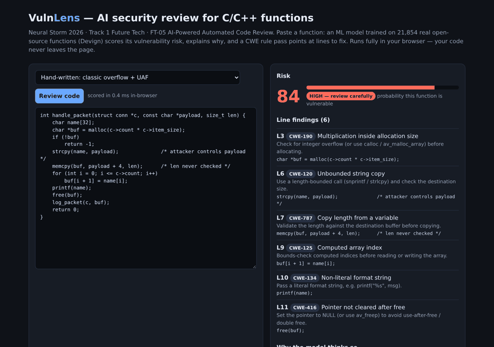
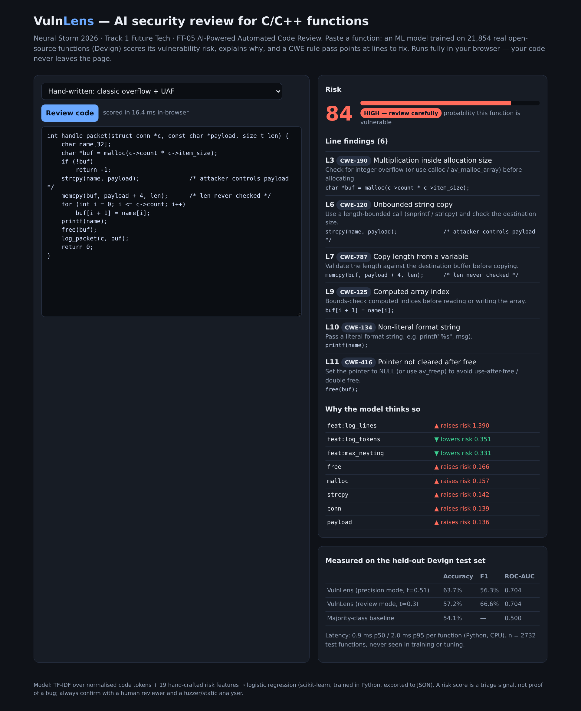
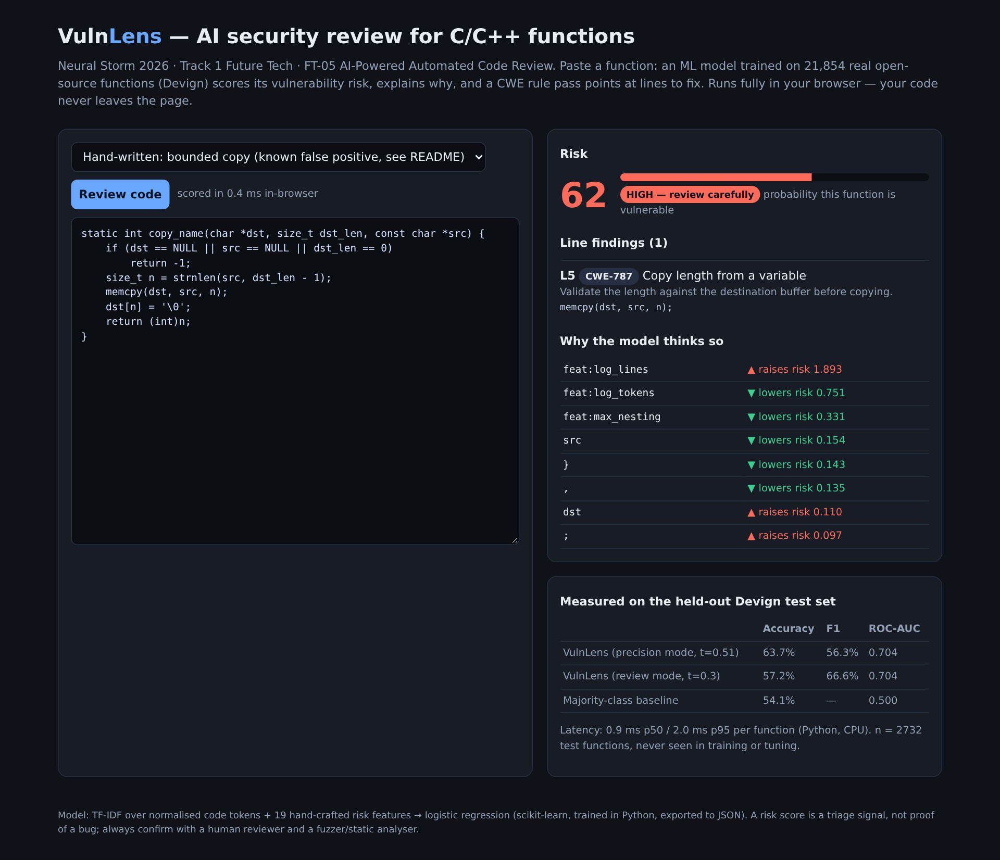

# VulnLens — AI security code review for C/C++ functions

**Neural Storm 2026 · Track 1: Future Tech · Problem statement FT-05: AI-Powered Automated Code Review**

**Team:** VulnLens (solo) · **Member:** Kanish Patidar (B.Tech CSE, LNCT Bhopal) · GitHub [@AuraFamerCode](https://github.com/AuraFamerCode)

**Live demo:** _(Netlify link goes here once deployed)_ · runs 100% in the browser, no code leaves your machine.



---

## 1. Problem

Memory-safety bugs (buffer overflows, use-after-free, integer overflows) are still the largest class of exploited vulnerabilities in C/C++ code. They hide in large code bases like FFmpeg and QEMU and get missed in pull-request review, because reviewers are short on time and the code looks fine at a glance.

Teams need a fast first pass that answers two questions for every function in a diff:
1. **How risky is this function?** So reviewers spend their attention where it matters.
2. **Which line is the problem, and what should I do about it?**

## 2. Solution

VulnLens is a lightweight ML reviewer that does both, in about **1 ms per function on a CPU**:

| Layer | What it does | Why |
|---|---|---|
| **ML risk model** (Python, scikit-learn) | TF-IDF over *normalised* code tokens (comments removed, string/number literals abstracted) + 19 hand-crafted risk features (nesting depth, pointer arithmetic, casts, `sizeof`, NULL checks, unsafe-copy / alloc / free calls…) → logistic regression | Learns which code patterns co-occur with real vulnerability-fixing commits. Linear, so every score is **explainable**. |
| **Explanations** | Per-function top contributions (weight × value) from the model | The reviewer sees *why*: e.g. `strcpy ▲`, `feat:max_nesting ▼`. |
| **CWE line rules** | 8 targeted rules (CWE-120, 125, 134, 190, 416, 770, 787) with fix advice | Points at the line to fix; the ML score ranks, the rules locate. |
| **Three ways to use it** | Static web app (Netlify), Gradio app, and a CLI / CI gate (`review.py --fail-above 0.7` exits 1) | Fits a browser demo, a local tool, and a GitHub Actions check. |

The browser demo uses the *same* model: training exports the vocabulary, IDF weights and coefficients to `web/model.json` (≈0.97 MB), and `web/vulnlens.js` re-implements tokenisation, features and scoring. A test runs the JS in Node on 200 real test functions and checks it **matches the Python scorer to 1e-6**.

## 3. Dataset

**CodeXGLUE Defect Detection (Devign)**, Zhou et al., NeurIPS 2019 ([HF: `google/code_x_glue_cc_defect_detection`](https://huggingface.co/datasets/google/code_x_glue_cc_defect_detection)): 27,318 real C functions from **FFmpeg** and **QEMU**, labelled vulnerable / not vulnerable through manual commit analysis. Official splits: train 21,854 · validation 2,732 · test 2,732.

## 4. Results (held-out test set, touched once)

Hyper-parameters (vocabulary size, C) were picked on the validation split only, and so were both thresholds. The test split was then scored **once**. Reproduce with `python train.py`; every number below comes from [`results/metrics.json`](results/metrics.json).

| Model (Devign test, n = 2,732) | Accuracy | F1 | ROC-AUC |
|---|---|---|---|
| Majority class | 54.1% | — | 0.500 |
| BiLSTM *(CodeXGLUE paper)* | 59.37% | — | — |
| TextCNN *(CodeXGLUE paper)* | 60.69% | — | — |
| RoBERTa *(CodeXGLUE paper)* | 61.05% | — | — |
| CodeBERT, 125M params, GPU fine-tuned *(CodeXGLUE paper)* | 62.08% | — | — |
| **VulnLens, precision mode** (t = 0.51) | **63.65%** (95% CI 61.9–65.5) | 56.3% (CI 53.6–58.6) | **0.704** |
| **VulnLens, review mode** (t = 0.30) | 57.2% | **66.6%** (CI 64.9–68.3), recall 92.7% | 0.704 |

- **Precision mode** confusion matrix: TN 1100 · FP 377 · FN 616 · TP 639 (precision 62.9%, recall 50.9%).
- **Review mode** is the setting for PR triage: it flags **93% of truly vulnerable functions** and clears 401 of 1,477 safe ones (27%) for a lighter look.
- **Per project:** QEMU 65.8% (n = 1,756), FFmpeg 59.8% (n = 976).
- **Leakage check:** 17 test functions are exact duplicates of training functions after normalisation. Accuracy without them is 63.9%, so the result does not come from memorisation.
- **Latency** (end to end: tokenise, features, predict; 2-core ARM CPU, no GPU): **0.95 ms p50 / 2.0 ms p95** per function, and **~2,400 functions/s** batched. In the browser, a function scores in a few ms.
- **Model selection grid** (validation accuracy): 10k terms 64.0–64.9%, **30k terms 65.0–66.0% (picked)**, 100k terms ≈64.9%.

**Honest framing.** VulnLens is on par with or slightly above the published CodeBERT baseline at a tiny fraction of the cost: no GPU, about 1 ms, and a 1 MB model that runs in the browser. The confidence intervals overlap, so we do **not** claim it is significantly better. Newer large models (for example UniXcoder- or LLM-based detectors) report higher accuracy on Devign. Devign is a hard and noisy benchmark, and no method gets far past ~70%.

## 5. Screenshots

| High-risk function: 6 CWE findings + explanation | Real QEMU function the model clears |
|---|---|
|  |  |

## 6. Tech stack

Python 3.12 · scikit-learn · NumPy / pandas / SciPy · pyarrow · Gradio (local app) · pytest · vanilla HTML/JS (static web demo, deployable on Netlify) · Node (JS/Python parity test only).

## 7. Setup and run

```bash
git clone https://github.com/AuraFamerCode/vulnlens && cd vulnlens
python -m venv .venv && source .venv/bin/activate      # Windows: .venv\Scripts\activate
pip install -r requirements.txt

python scripts/get_data.py      # downloads the 3 Devign parquet files (~22 MB) into data/
python train.py                 # ~5 min on a laptop CPU; writes models/, results/metrics.json, web/model.json
pytest -q                       # 9 tests (unit, model round-trip, JS/Python parity, metric sanity)

python app.py                   # Gradio UI on http://127.0.0.1:7860
python review.py samples/demo.c                 # CLI: ranks every function in a file
python review.py samples/demo.c --fail-above 0.7 # CI gate: exit code 1 if any function is riskier

cd web && python -m http.server 8000             # static demo on http://localhost:8000
```

A trained model is already committed (`web/model.json`, `models/vulnlens.joblib`), so the demo works without retraining.

**Deploy:** the `web/` folder is a static site. `netlify.toml` publishes it as is (no build step).

## 8. Repository layout

```
vulnlens/tokenize.py   code normalisation + tokeniser
vulnlens/features.py   19 explainable risk features
vulnlens/rules.py      CWE line rules with fix advice
vulnlens/model.py      model, explanations, JSON export, reference web scorer
train.py               model selection, thresholds, test evaluation, CIs, leakage check, latency
app.py / review.py     Gradio app / CLI + CI gate
web/                   static in-browser demo (index.html, vulnlens.js, model.json, metrics.json, examples.json)
tests/                 pytest suite
```

## 9. Limitations and responsible use

- **It triages, it does not prove.** About 1 in 3 "high" flags in precision mode is a false positive, and half of real bugs score below the precision threshold (review mode raises recall to 93% at the cost of more flags). Always confirm with a human reviewer, a sanitiser (ASan/UBSan) or a fuzzer.
- **Known false positive:** the demo includes a correctly bounded `memcpy` that still scores ~62%. A bag-of-tokens model sees `memcpy` with a variable length and cannot tell that `n` was clamped. Data-flow-aware models (graphs, or code LLMs) are the natural next step.
- **Domain:** trained only on FFmpeg + QEMU C code. Expect lower accuracy on other code styles or C++-heavy code.
- **Privacy:** the web demo runs entirely client-side, and pasted code is never sent anywhere.

## 10. Built during Neural Storm, and AI-assistance disclosure

All code in this repository was written during the official hackathon window (2–4 Nov 2026). The git history shows the timeline.

**AI tools used (disclosed as the rules require):** this project was built with substantial help from an **AI coding assistant (Hark, an LLM-based agent)**. It wrote large parts of the code, ran the experiments and drafted this README under my direction. I chose the problem and approach, reviewed the code and results, and am responsible for the submission. Every metric was produced by running `train.py` on the public dataset, and none was typed in by hand.

## 11. References

- Zhou et al., *Devign: Effective Vulnerability Identification by Learning Comprehensive Program Semantics via Graph Neural Networks*, NeurIPS 2019.
- Lu et al., *CodeXGLUE: A Machine Learning Benchmark Dataset for Code Understanding and Generation*, 2021 (baseline numbers from the [Defect-detection README](https://github.com/microsoft/CodeXGLUE/tree/main/Code-Code/Defect-detection)).
- MITRE CWE: CWE-120, 125, 134, 190, 416, 770, 787.

License: MIT.
